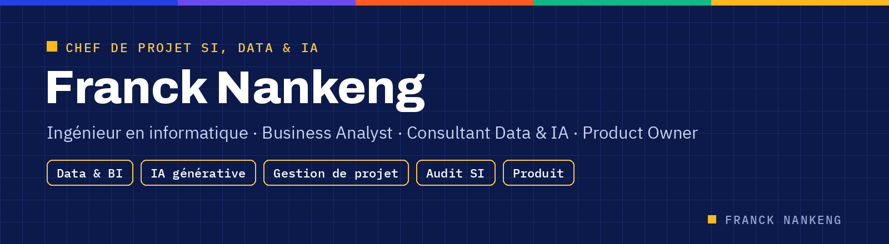

Ingénieur en informatique (3iL Limoges), je pilote des projets data et IA de bout en bout : identifier les cas d'usage avec les métiers, les prioriser, construire la roadmap, puis livrer avec les équipes techniques jusqu'à l'adoption.

Disponible immédiatement · CDI, CDD ou mission en freelance · [LinkedIn](https://www.linkedin.com/in/franck-nankeng-51b43b297/)

  
  
  
  
  
  
  
  
  
  

### Projets principaux

<table>
  <tr>
    <td width="50%" valign="top">
      
      <b>Groupe Orvane</b> · reporting Power BI d'un groupe de 11 filiales : 24 tables, 143 mesures DAX, sécurité par filiale.
    </td>
    <td width="50%" valign="top">
      
      <b>Horizon_Contrat</b> · pilotage d'un réseau de 120 restaurants sous Excel : Power Query, Power Pivot, VBA, simulateur.
    </td>
  </tr>
  <tr>
    <td width="50%" valign="top">
      
      <b>Process mining d'un cycle achats</b> · 2 000 commandes analysées avec PM4Py, note d'audit en quatre constats.
    </td>
    <td width="50%" valign="top">
      
      <b>Projets IA & machine learning</b> · classification, ACP, deep learning : quatre notebooks exécutés et mesurés.
    </td>
  </tr>
</table>

### Autres projets

| Projet | En bref |
|---|---|
| [Fréquentation des cinémas en France](https://github.com/Nganou1/Analyse_des_fr-quences_des_-volutions_des_cin-mas) | Power BI · entrées, recettes et séances de 1938 à 2020 |
| [Performance commerciale d'un réseau de magasins](https://github.com/Nganou1/Creation_de_dasbord_pour_analyses_des_performances_de_ventes_pour_magasin_main) | Power BI · ventes, profit et marge par région et catégorie |
| [Gestion de pharmacie](https://github.com/Nganou1/Pharma-main) | PHP · Symfony 6 · catalogue, stocks et péremption |
| [Cahier de texte numérique](https://github.com/Nganou1/Cahier_de_texte-main) | PHP · MySQL · suivi des séances par classe |
| [Maison intelligente](https://github.com/Nganou1/Smart_House_main) | HTML · CSS · JavaScript · site vitrine responsive |

Les projets Orvane, Horizon_Contrat et process mining sont des cas d'étude sur données simulées.
